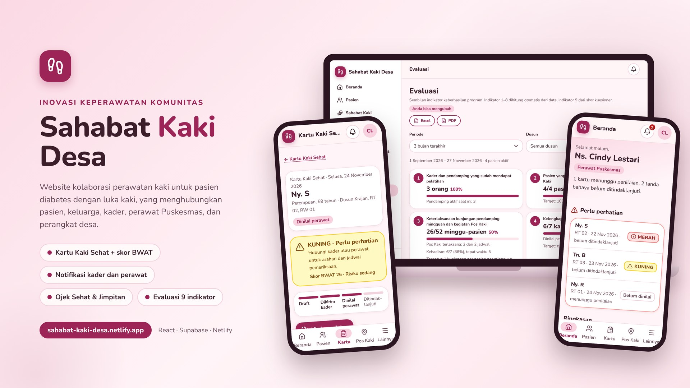

# Sahabat Kaki Desa



**Website kolaborasi perawatan kaki untuk pasien diabetes melitus dengan luka kaki.**
Satu tempat bagi pasien, keluarga, kader, perawat Puskesmas, dan perangkat desa untuk
memantau dan menindaklanjuti kondisi kaki pasien.

**Coba langsung:** [sahabat-kaki-desa.netlify.app](https://sahabat-kaki-desa.netlify.app)

## Tentang proyek

Website ini saya bangun untuk mahasiswa Program Studi Sarjana Keperawatan, Fakultas Ilmu
Kesehatan, Universitas Brawijaya (Kelompok 2, mata kuliah Keperawatan Kronis). Website ini
adalah prototipe dari inovasi dalam makalah mereka, *Pengembangan Inovasi Keperawatan
Komunitas Berbasis Community Resources and Policies untuk Meningkatkan Dukungan Sosial dan
Kemandirian Pasien Diabetes Melitus dengan Luka Kaki*, dan dipakai untuk presentasi serta
roleplay di kelas.

Program di makalah punya tiga komponen: **Sahabat Kaki** (pendamping tetangga), **Kartu Kaki
Sehat** (kode warna hijau, kuning, merah), serta **Jimpitan Sehat dan Pos Kaki** (iuran
gotong royong untuk transportasi dan pemeriksaan kaki). Sebelumnya semua itu berjalan lewat
kertas dan grup WhatsApp. Website ini menyatukannya menjadi satu riwayat pasien yang bisa
dilanjutkan oleh siapa pun yang berwenang, dari HP atau laptop mana pun.

Kasus acuannya adalah Ny. S, 59 tahun, diabetes tipe 2 selama 12 tahun dengan luka kaki
3 bulan. Semua data di website adalah data contoh fiktif.

## Fitur utama

| Peran | Yang bisa dilakukan |
| --- | --- |
| Kader | Mendampingi pasien, mencatat kunjungan, mengisi Kartu Kaki Sehat, melapor ke perawat, memesan Ojek Sehat |
| Perawat Puskesmas | Menilai luka dengan skor BWAT, menulis SBAR dan arahan, merujuk, mengisi kuesioner, melihat evaluasi |
| Pasien / Keluarga | Melihat kondisi kaki dan arahan perawat, mencetak kartu, ikut kegiatan desa |
| Perangkat Desa | Mengelola Jimpitan Sehat dan sumber daya desa, memantau ringkasan tanpa melihat data medis |
| Admin | Menyetujui akun baru dan menjaga data program tetap rapi |

- **Kode warna terukur.** Skor Bates-Jensen Wound Assessment Tool (13 butir) menentukan warna
  otomatis: 13–20 hijau, 21–40 kuning, 41–65 merah. Perawat boleh menaikkan warna, tidak
  bisa menurunkannya.
- **Notifikasi langsung.** Laporan kader muncul di lonceng perawat, dan arahan perawat kembali
  ke kader tanpa perlu dimuat ulang.
- **Kartu Kaki Sehat cetak.** PDF satu halaman berisi riwayat, kode warna, dan kolom paraf
  kader serta perawat.
- **Ojek Sehat terhubung ke Jimpitan.** Biaya perjalanan tercatat sebagai pengeluaran dana
  warga, lengkap dengan laporan bulanan.
- **Evaluasi 9 indikator.** Delapan indikator dihitung otomatis dari data; indikator
  kesembilan memakai kuesioner WHOQOL-BREF, MSPSS, dan SDSCA. Bisa diunduh sebagai Excel
  atau PDF.
- **Ramah pengguna lansia.** Mobile-first dari lebar 360 px, teks minimal 16 px, dan
  animasi yang otomatis mati bila perangkat meminta "kurangi gerakan".

## Dibangun dengan apa?

Sahabat Kaki Desa **bukan aplikasi native** (bukan aplikasi Android atau iOS yang diunduh
dari Play Store). Ini adalah **aplikasi web** yang dibangun dengan framework JavaScript
modern dan dibuka lewat browser. Karena tampilannya mobile-first, rasanya seperti aplikasi
saat dibuka di HP.

| Bagian | Teknologi | Fungsinya |
| --- | --- | --- |
| Antarmuka | [React 19](https://react.dev) (JavaScript) | Menyusun tampilan dari komponen yang bisa dipakai ulang |
| Build tool | [Vite 8](https://vite.dev) | Server pengembangan cepat dan build produksi |
| Tampilan | [Tailwind CSS 4](https://tailwindcss.com) | Gaya dan tema warna "Rose Lembut" |
| Navigasi | [React Router 8](https://reactrouter.com) | Perpindahan halaman tanpa memuat ulang |
| Backend | [Supabase](https://supabase.com) | Login, database PostgreSQL dengan Row Level Security, penyimpanan foto privat, dan notifikasi realtime |
| Grafik | [Chart.js](https://www.chartjs.org) | Grafik di halaman Evaluasi |
| Ekspor | [SheetJS](https://sheetjs.com) dan [jsPDF](https://github.com/parallax/jsPDF) | Laporan Excel dan PDF, serta Kartu Kaki Sehat cetak |
| Hosting | [Netlify](https://www.netlify.com) | Website publik dengan HTTPS |

Aturan siapa boleh melihat dan mengubah data dijaga langsung di database (Row Level
Security), bukan hanya disembunyikan di tampilan. Aturan itu disusun dalam 9 file migrasi
SQL dan diuji dengan 193 skenario hak akses.

## Dokumen proyek

- Kebutuhan produk: [`docs/PRD.md`](docs/PRD.md)
- Keputusan tambahan (hal yang ambigu di PRD, pilihan desain): [`docs/KEPUTUSAN.md`](docs/KEPUTUSAN.md)

---

# Panduan menjalankan dan mengembangkan

Bagian di bawah ini untuk yang ingin menjalankan website di laptop sendiri atau
memasangnya ulang.

## A. Persiapan di laptop Windows (sekali saja)

Semua perintah diketik di **PowerShell**. Cara membukanya: tekan tombol Windows, ketik
`PowerShell`, lalu tekan Enter. Ketik satu perintah, tekan Enter, dan tunggu sampai
selesai sebelum mengetik perintah berikutnya.

1. **Pasang Node.js** (menjalankan website di laptop). Unduh versi **LTS** dari
   <https://nodejs.org>, lalu pasang dengan tombol Next sampai selesai. Tutup PowerShell,
   buka lagi, lalu cek versinya. Hasilnya harus `v22.22` atau lebih baru (misalnya `v24.x`).
   ```powershell
   node -v
   ```
2. **Pasang Git** (mengambil kode dari GitHub) dari <https://git-scm.com/download/win>
   (cukup tekan Next terus). Cek:
   ```powershell
   git --version
   ```
3. **Ambil kode proyek.** Perintah pertama mengunduh kode, perintah kedua masuk ke
   foldernya, dan perintah ketiga pindah ke versi terbaru yang sedang dikerjakan.
   ```powershell
   git clone https://github.com/zuliandwisaputra/Sahabat-Kaki-Desa.git
   ```
   ```powershell
   cd Sahabat-Kaki-Desa
   ```
   ```powershell
   git checkout claude/dazzling-wright-11fnuf
   ```

### A2. Alternatif: memakai Laragon

Laragon bisa dipakai sebagai pengganti langkah 1–2 di atas, karena Laragon Full sudah
membawa Node.js dan Git. Database **tetap di Supabase** (online); Apache dan MySQL milik
Laragon tidak dipakai, jadi tidak perlu menekan "Start All".

1. Pasang **Laragon Full** dari <https://laragon.org/download>, lalu buka.
2. Klik kanan di jendela Laragon → **Node.js** → pilih versi **24** atau yang terbaru
   (minimal 22.22). Kalau belum ada, tambahkan lewat **Tools → Quick add**.
3. Klik tombol **Terminal** di Laragon, lalu ketik satu per satu:
   ```
   cd C:\laragon\www
   git clone https://github.com/zuliandwisaputra/Sahabat-Kaki-Desa.git
   cd Sahabat-Kaki-Desa
   git checkout claude/dazzling-wright-11fnuf
   ```
4. Lanjutkan ke bagian B dan C. Bedanya, di terminal Laragon pakai `copy` (bukan
   `Copy-Item`):
   ```
   copy .env.example .env
   ```
   Website dibuka di **http://localhost:5173**, bukan alamat `.test` dari Laragon.

## B. Menyiapkan Supabase (database + login)

1. Buka <https://supabase.com>, daftar atau masuk, lalu klik **New project**.
   - Name: `sahabat-kaki-desa`
   - Database Password: buat password lalu **simpan baik-baik**
   - Region: **Southeast Asia (Singapore)**, supaya lebih cepat dari Indonesia

   Tunggu sekitar 2 menit sampai proyek siap.
2. **Jalankan migrasi database.** Semua file ada di folder `supabase/migrations/`.
   Jalankan **berurutan dari 1 sampai 9**:
   1. Di Supabase, buka menu **SQL Editor**, lalu klik **New query**.
   2. Buka file migrasi dengan Notepad atau VS Code, tekan Ctrl+A lalu Ctrl+C, dan tempel
      (Ctrl+V) di SQL Editor.
   3. Klik **Run**. Hasilnya harus *Success*. Jika muncul peringatan, pilih **Run this query**.

   | Urutan | File | Isi |
   |---|---|---|
   | 1 | `20261125000100_tabel.sql` | 23 tabel |
   | 2 | `20261125000200_fungsi_peran.sql` | fungsi pengecek peran |
   | 3 | `20261125000300_rls.sql` | aturan hak akses (RLS) |
   | 4 | `20261125000400_trigger.sql` | profil otomatis, log aktivitas, notifikasi |
   | 5 | `20261125000500_rpc.sql` | fungsi untuk aplikasi |
   | 6 | `20261125000600_storage_realtime.sql` | penyimpanan foto privat + Realtime |
   | 7 | `20261125000700_artikel_edukasi.sql` | 4 artikel edukasi bawaan |
   | 8 | `20261126000100_skor_bwat.sql` | skor luka BWAT untuk kode warna |
   | 9 | `20261126000200_evaluasi.sql` | 9 indikator Evaluasi + rekap kuesioner |

   > Kalau satu file gagal, **jangan lanjut ke file berikutnya**. Salin pesan error-nya dan
   > tanyakan dulu.
3. **Matikan konfirmasi email SEBELUM mendaftarkan akun apa pun.** Buka
   **Authentication → Sign In / Providers → Email**, matikan **Confirm email**, lalu klik
   Save. Akun yang terdaftar sebelum ini dimatikan tetap dianggap belum terkonfirmasi dan
   tidak bisa masuk.

   Ini perlu karena layanan email gratis Supabase hanya bisa mengirim ke email anggota tim
   proyek Supabase, dan hanya beberapa email per jam. Kalau konfirmasi tidak dimatikan,
   pendaftaran memakai email lain akan gagal.
4. **Alamat website.** Buka **Authentication → URL Configuration**:
   - Site URL: `http://localhost:5173`
   - Redirect URLs: tambahkan `http://localhost:5173/**`
5. **Salin kunci.** Buka **Project Settings → API Keys** (atau tombol **Connect**), lalu salin:
   - **Project URL**, contohnya `https://abcdxyz.supabase.co`. Bagian `abcdxyz` sama dengan
     kode proyek yang tampil di alamat browser: `supabase.com/dashboard/project/abcdxyz`.
   - **Publishable key** yang diawali `sb_publishable_`. Jika hanya ada **anon key**
     (cara lama), anon key juga bisa dipakai.

   ⚠️ **Jangan** salin *service_role* / *secret key* ke file `.env`.

## C. Menjalankan website di laptop

1. Buat file `.env` dari contohnya, lalu buka dengan Notepad. Perintah pertama menyalin
   file, perintah kedua membukanya.
   ```powershell
   Copy-Item .env.example .env
   ```
   ```powershell
   notepad .env
   ```
   Isi dua baris ini dengan nilai dari langkah B.5, lalu simpan (Ctrl+S) dan tutup Notepad:
   ```
   VITE_SUPABASE_URL=https://abcdxyz.supabase.co
   VITE_SUPABASE_ANON_KEY=sb_publishable_xxxxxxxx
   ```
2. Pasang paket-paket website. Cukup sekali, dan butuh 1–2 menit.
   ```powershell
   npm install
   ```
3. Jalankan website:
   ```powershell
   npm run dev
   ```
   Buka <http://localhost:5173> di Chrome. Biarkan jendela PowerShell tetap terbuka selama
   mencoba. Untuk menghentikan, tekan **Ctrl+C** di PowerShell.

### Membuat akun Admin pertama

Admin tidak bisa dipilih di halaman Daftar.

1. Daftar akun biasa di website, misalnya dengan username `admin` dan peran apa saja.
2. Di Supabase **SQL Editor**, jalankan:
   ```sql
   update public.profiles set role = 'admin', approval_status = 'disetujui' where username = 'admin';
   ```
3. Muat ulang website (F5). Menu **Kelola Akun** akan muncul.

### Data contoh & 5 akun untuk roleplay

1. **Data contoh** (semua fiktif: Ny. S dan 3 pasien lain, kunjungan, Kartu Kaki Sehat,
   Pos Kaki, Ojek Sehat, Jimpitan, kegiatan, kuesioner awal & ulang). Di Supabase
   **SQL Editor**, buka `supabase/seed.sql`, salin semua, lalu **Run**. Aman dijalankan ulang.
   ```powershell
   notepad supabase\seed.sql
   ```
2. **Kunci rahasia untuk script.** Buat file `.env.local` (sudah diabaikan Git, tidak ikut
   ke GitHub):
   ```powershell
   notepad .env.local
   ```
   Isi dengan (ambil **secret key / service_role** di Project Settings → API Keys):
   ```
   SUPABASE_URL=https://abcdxyz.supabase.co
   SUPABASE_SERVICE_ROLE_KEY=sb_secret_xxxxxxxx
   DEMO_PASSWORD=GantiPasswordIni123
   ```
   ⚠️ Kunci ini bisa membuka **semua** data. Jangan dibagikan, jangan ditaruh di `.env`.
3. **Buat 5 akun** (Admin, Perawat, Kader, Pasien/Keluarga, Perangkat Desa) dan hubungkan
   akun keluarga ke Ny. S:
   ```powershell
   npm run akun-demo
   ```
   Terminal menampilkan tabel username & email beserta passwordnya. Bagikan hanya ke
   anggota kelompok dan dosen.

---

## C2. Deploy gratis ke Netlify

1. Pastikan kode terbaru sudah ada di GitHub (branch yang dipakai).
2. Buka <https://app.netlify.com>, masuk dengan GitHub, klik **Add new project → Import an
   existing project → GitHub**, pilih repo `Sahabat-Kaki-Desa`.
3. **Branch to deploy**: pilih branch yang berisi kode ini. Pengaturan build terbaca otomatis
   dari `netlify.toml` (`npm run build`, folder `dist`, Node 24).
4. Sebelum deploy, buka **Environment variables** dan tambahkan dua variabel yang sama
   dengan isi `.env` Anda:
   - `VITE_SUPABASE_URL`
   - `VITE_SUPABASE_ANON_KEY` (publishable key)

   **Jangan** menambahkan service role / secret key di Netlify.
5. Klik **Deploy**. Setelah selesai, Anda mendapat alamat seperti
   `https://sahabat-kaki-desa.netlify.app` (nama bisa diganti di **Site configuration →
   Change site name**).
6. Di Supabase **Authentication → URL Configuration**:
   - **Site URL**: ganti dengan alamat Netlify Anda.
   - **Redirect URLs**: tambahkan `https://NAMA-SITUS.netlify.app/**` (biarkan juga
     `http://localhost:5173/**` supaya tetap bisa dicoba di laptop).
7. Buka alamat Netlify di HP. Yang pertama muncul harus halaman **Masuk**.

Setiap kali kode di branch tersebut diperbarui (push), Netlify otomatis membangun ulang.

---

## D. Struktur folder

```
docs/                 PRD, keputusan tambahan, gambar diagram
supabase/migrations/  file SQL database (tabel, RLS, trigger, fungsi, storage)
tests/db/             uji hak akses per peran (untuk pengembang, PostgreSQL lokal)
src/
  lib/                klien Supabase, matriks hak akses, format tanggal/rupiah
  context/            status login (AuthContext), pesan singkat (Toast)
  components/         tata letak (sidebar, navigasi bawah, lonceng) + komponen tampilan
  pages/              halaman: auth, beranda, profil, kelola-akun, dll.
netlify.toml          pengaturan deploy Netlify (redirect SPA)
```

## E. Keamanan

- Di frontend hanya ada **URL + anon/publishable key**. Keduanya memang dirancang untuk
  publik, karena data dilindungi **Row Level Security** di database.
- **Service role key tidak boleh** ada di frontend maupun di GitHub. Kunci ini nanti
  dipakai script akun demo, dan disimpan hanya di `.env.local` di laptop. File itu sudah
  masuk `.gitignore`, jadi tidak ikut diunggah.
- Hak akses diterapkan di dua lapis: tombol disembunyikan di tampilan, **dan** database
  menolak perubahan dari peran yang tidak berwenang.
- Foto luka dan bukti transaksi disimpan di bucket **privat** dan dibuka lewat link
  sementara (signed URL).

## F. Untuk pengembang: uji hak akses database

`tests/db/run.sh` menjalankan semua migrasi di PostgreSQL lokal (15+) dengan tiruan
Supabase (dua mode hak bawaan), lalu menguji 193 skenario hak akses per peran:

```bash
bash tests/db/run.sh
```

## G. Catatan Supabase paket Free

Proyek gratis otomatis di-*pause* jika sekitar seminggu tidak dipakai. Buka website atau
dashboard Supabase sehari sebelum presentasi.
