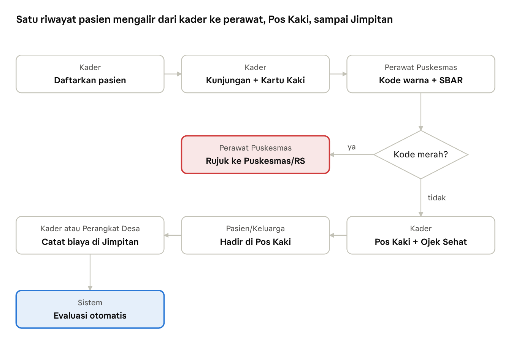
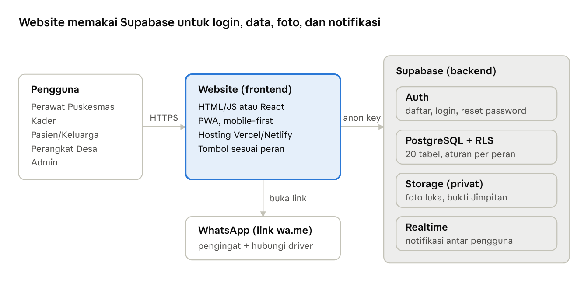
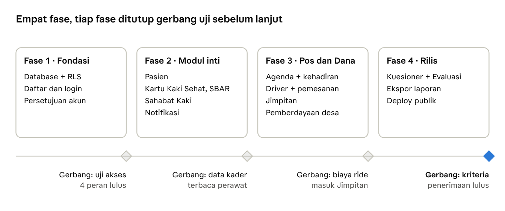

# PRD Website Sahabat Kaki Desa

Nov 25, 2026 · @Zulian Dwi Saputra

## 1. Ringkasan Produk

Sahabat Kaki Desa adalah website kolaborasi untuk program perawatan kaki pasien (fokus pada pencegahan dan pemantauan luka kaki, misalnya kaki diabetik) di tingkat desa. Satu database pasien dipakai bersama oleh Perawat Puskesmas, Kader, Pasien/Keluarga, dan Perangkat Desa, dengan hak edit yang berbeda per peran.

**Latar belakang masalah**

- Data kunjungan kader, penilaian perawat, jadwal Pos Kaki, dan dana Jimpitan tercatat terpisah (kertas, chat, atau file masing-masing), sehingga riwayat pasien tidak utuh.

- Versi website sebelumnya masih berupa latihan: data tersimpan di browser (localStorage), tidak ada login, dan tidak bisa dipakai bersama dari perangkat berbeda.

- Pasien sering terkendala transportasi ke Pos Kaki, dan pembiayaannya dari dana Jimpitan belum tercatat rapi.

**Visi produk**

Satu website yang sudah dipublikasikan (bukan mode latihan), wajib login, bisa diakses tanpa batas jumlah pengguna, dan menyatukan alur Kader → Perawat → Pos Kaki → Jimpitan dalam satu riwayat pasien.

**Konteks proyek**

- Pemilik kebutuhan: kelompok mahasiswa keperawatan (Angel dan tim), sebagai pendukung tugas Kasus 2.

- Tahap awal dipakai untuk uji coba dengan data pasien fiktif, lalu disiapkan agar layak untuk data nyata.

**Kaitan dengan Tugas Inovasi TM 15 (Kelompok 2: Community Resources and Policies)**

Website ini adalah prototipe untuk tugas kelompok poin 4, "prototipe program pemberdayaan atau mekanisme kolaborasi". Kasus acuannya adalah Ny. S (59 tahun, diabetes tipe 2 selama 12 tahun, luka kaki 3 bulan) yang terkendala transportasi, merasa menjadi beban keluarga, dan tinggal di wilayah dengan Posbindu PTM, kader, PKK, dan komunitas senam lansia yang belum terintegrasi.

| Tugas kelompok                                          | Dijawab di PRD ini                                                                                          |
|---------------------------------------------------------|-------------------------------------------------------------------------------------------------------------|
| 1\. Identifikasi sumber daya dan kebijakan lokal        | Modul Pemberdayaan dan Sumber Daya Desa (5.10)                                                              |
| 2\. Analisis hambatan sosial, ekonomi, akses            | Pos Kaki + driver (akses), Jimpitan (ekonomi), edukasi anti-stigma (sosial); analisis lengkapnya di makalah |
| 3\. Penghubung pasien, keluarga, kader, faskes          | Empat POV dan alur utama (bagian 3, 4, 7)                                                                   |
| 4\. Prototipe pemberdayaan atau mekanisme kolaborasi    | Website ini, dengan scope prototipe di bagian 12                                                            |
| 5\. Indikator partisipasi masyarakat dan kualitas hidup | Modul Evaluasi (5.8) dan Kuesioner (5.11)                                                                   |

Isi PRD mengikuti makalah Kelompok 2, "Pengembangan Inovasi Keperawatan Komunitas Berbasis Community Resources and Policies...": tiga komponen (Sahabat Kaki, Kartu Kaki Sehat, Jimpitan Sehat dan Pos Kaki), kode warna hijau/kuning/merah, serta istilah Ojek Sehat, Duta Kaki Sehat, dan grup koordinasi Siaga Kaki. Website lama di Lampiran 1 makalah masih menyimpan data di browser dan berlabel latihan; versi dalam PRD ini menggantikannya.

## 2. Tujuan dan Metrik Keberhasilan

Tujuan utamanya: setiap pasien punya satu riwayat perawatan kaki yang bisa dilanjutkan oleh siapa pun yang berwenang, dari perangkat mana pun.

| Tujuan                                                   | Metrik                                                                         | Target uji coba                           |
|----------------------------------------------------------|--------------------------------------------------------------------------------|-------------------------------------------|
| Data pasien terpusat                                     | Pasien yang punya riwayat kunjungan lengkap di sistem                          | 100% pasien uji                           |
| Pendampingan Sahabat Kaki berjalan                       | Jumlah pasien dengan pendamping dan jumlah kunjungan mingguan                  | Minimal 1 kunjungan per pasien per minggu |
| Kartu Kaki Sehat terisi dan ditindaklanjuti              | Kartu lengkap + sudah ditinjau perawat                                         | ≥ 90% kartu ditinjau dalam 2×24 jam       |
| Akses pelayanan membaik                                  | Kehadiran Pos Kaki, ketepatan kontrol, penggunaan transportasi                 | ≥ 80% pasien hadir sesuai jadwal          |
| Partisipasi masyarakat meningkat                         | Kader aktif, warga ikut iuran Jimpitan, driver relawan, kehadiran senam lansia | Naik dibanding bulan pertama              |
| Dukungan sosial, kemandirian, dan kualitas hidup membaik | Skor kuesioner terstandar awal vs 3 bulan                                      | Skor naik atau minimal tetap              |
| Dana Jimpitan transparan                                 | Transaksi tercatat dengan bukti dan saldo sesuai                               | 100% transaksi punya keterangan           |
| Akses aman                                               | Tidak ada pengguna yang bisa mengedit di luar wewenangnya                      | 0 pelanggaran pada uji akses              |

Catatan: dukungan sosial, kemandirian, dan kualitas hidup tidak dihitung otomatis dari data aplikasi. Nilainya diambil dari kuesioner terstandar yang diisi perawat lewat modul Kuesioner (5.11), karena indikator ini diminta langsung di tugas Kelompok 2 poin 5. Angka target adalah usulan awal dan bisa disesuaikan dengan makalah kelompok.

## 3. Pengguna dan Peran

Ada empat POV sesuai permintaan, ditambah satu peran Admin (tambahan) untuk menyetujui akun dan mengatur sistem. Label POV ditulis tanpa garis miring: "Kader" (bukan Kader/PKK) dan "Perangkat Desa" (bukan Perangkat Desa/Posbindu).

| Peran             | Siapa                                                                     | Kebutuhan utama                                                                                                |
|-------------------|---------------------------------------------------------------------------|----------------------------------------------------------------------------------------------------------------|
| Perawat Puskesmas | Perawat penanggung jawab wilayah (contoh: Perawat Cindy dan perawat lain) | Menilai kondisi kaki, menulis SBAR, memberi rekomendasi dan rujukan, mengelola seluruh data                    |
| Kader             | Kader kesehatan desa (ex-PKK)                                             | Mendaftarkan pasien, mencatat kunjungan Sahabat Kaki, mengisi Kartu Kaki Sehat, mengatur Pos Kaki dan Jimpitan |
| Pasien/Keluarga   | Pasien atau anggota keluarga pendamping                                   | Melihat progres perawatan, jadwal, dan edukasi; mengisi identitas diri sendiri                                 |
| Perangkat Desa    | Aparat desa yang mengelola dana dan dukungan desa                         | Mengelola Jimpitan, mengisi info beranda desa                                                                  |
| Admin (tambahan)  | Ketua kelompok atau koordinator Puskesmas                                 | Menyetujui pendaftaran akun, mengubah peran, mengatur master data                                              |

**Aturan umum**

- Semua peran bisa melihat semua menu (mode baca), tetapi tombol tambah, ubah, dan hapus hanya muncul untuk peran yang berwenang.

- Akun Perawat, Kader, dan Perangkat Desa harus disetujui Admin dulu sebelum bisa mengedit, supaya orang luar tidak bisa mendaftar lalu langsung mengubah data klinis.

- Akun Pasien/Keluarga terhubung ke satu data pasien, jadi mereka hanya bisa mengisi identitas pasien yang terhubung dengan akunnya.

## 4. Matriks Hak Akses

Semua peran bisa melihat semua menu; perbedaannya ada di siapa yang boleh mengedit. "Edit" berarti tambah, ubah, dan hapus. "Lihat" berarti hanya baca.

| Menu                                         | Perawat Puskesmas                      | Kader                                              | Pasien/Keluarga                       | Perangkat Desa | Admin |
|----------------------------------------------|----------------------------------------|----------------------------------------------------|---------------------------------------|----------------|-------|
| Beranda                                      | Edit                                   | Edit                                               | Lihat                                 | Edit           | Edit  |
| Pasien                                       | Edit                                   | Edit                                               | Edit terbatas: identitas diri sendiri | Lihat          | Edit  |
| Sahabat Kaki                                 | Edit (termasuk memasangkan pendamping) | Edit terbatas: catat kunjungan pasien dampingannya | Lihat                                 | Lihat          | Edit  |
| Kartu Kaki Sehat                             | Edit (termasuk kode warna dan arahan)  | Edit (catatan pengamatan, tanpa kode warna)        | Lihat                                 | Lihat          | Edit  |
| Jimpitan Sehat                               | Edit                                   | Edit                                               | Lihat                                 | Edit           | Edit  |
| Pos Kaki                                     | Edit                                   | Edit                                               | Lihat                                 | Lihat          | Edit  |
| Pemberdayaan dan Sumber Daya Desa (tambahan) | Edit                                   | Edit                                               | Lihat + daftar ikut kegiatan          | Edit           | Edit  |
| Kuesioner (tambahan)                         | Edit                                   | Lihat rekap                                        | Lihat skor sendiri                    | Lihat rekap    | Edit  |
| Evaluasi                                     | Edit                                   | Lihat                                              | Lihat                                 | Lihat          | Edit  |
| Kelola Data                                  | Edit                                   | Lihat                                              | Lihat                                 | Lihat          | Edit  |
| Kelola Akun (tambahan)                       | Lihat                                  | Tidak tampil                                       | Tidak tampil                          | Tidak tampil   | Edit  |

Perbedaan dari daftar wewenang awal: Kader mendapat hak terbatas di Sahabat Kaki karena menurut makalah (subbab 2.1.1 dan 3.2) kader atau anggota PKK adalah pendamping yang melakukan kunjungan mingguan.

**Aturan privasi tambahan**

- Pasien/Keluarga hanya melihat data klinis (Kartu Kaki Sehat, foto luka, SBAR) milik pasien yang terhubung ke akunnya. Untuk pasien lain, mereka hanya melihat data ringkas tanpa identitas (misalnya jumlah pasien di dashboard).

- Perangkat Desa melihat data pasien dalam bentuk ringkas (nama, dusun, status kehadiran), tanpa foto luka dan catatan klinis.

- Hak akses diterapkan di dua lapis: tombol disembunyikan di tampilan, dan aturan database (Row Level Security) menolak perubahan dari peran yang tidak berwenang. Menyembunyikan tombol saja tidak cukup.

## 5. Kebutuhan Fungsional

Setiap modul di bawah diberi kode supaya mudah dirujuk saat membuat tugas dan pengujian.

### 5.1 Autentikasi dan Akun (AUTH)

- AUTH-01: Halaman pertama saat membuka link adalah halaman Masuk (username/email + password). Tidak ada halaman lain yang bisa dibuka sebelum login.

- AUTH-02: Halaman Daftar berisi nama lengkap, username, email, nomor HP, password, konfirmasi password, dan pilihan peran (POV).

- AUTH-03: Tombol tampil/sembunyikan password di form Masuk dan Daftar.

- AUTH-04: Akun Perawat, Kader, dan Perangkat Desa berstatus "Menunggu persetujuan" sampai disetujui Admin. Akun Pasien/Keluarga bisa langsung aktif dalam mode lihat, lalu dihubungkan ke data pasien oleh Perawat atau Kader.

- AUTH-05: Lupa password lewat link reset ke email.

- AUTH-06: Halaman Profil: ganti foto profil, nama, nomor HP, dan password.

- AUTH-07: Tidak ada batas jumlah akun maupun pengguna yang login bersamaan.

- AUTH-08: Tombol Keluar, dan sesi otomatis berakhir setelah tidak aktif beberapa waktu (misalnya 7 hari).

### 5.2 Beranda (HOME)

- HOME-01: Tampilan beranda berbeda per POV: judul sambutan, ringkasan tugas, dan pintasan sesuai peran.

- HOME-02: Kartu ringkasan: jumlah pasien aktif, kunjungan minggu ini, jadwal Pos Kaki terdekat, saldo Jimpitan.

- HOME-03: Pengumuman desa dan artikel edukasi kesehatan kaki (cara cuci kaki, memilih alas kaki, tanda bahaya luka).

- HOME-04: Peran yang berwenang bisa menambah atau mengubah pengumuman dan artikel.

### 5.3 Pasien (PAS)

- PAS-01: Daftar pasien dengan pencarian (nama, NIK opsional, dusun/RT) dan filter status (aktif, rujukan, selesai).

- PAS-02: Form identitas: nama, tanggal lahir, jenis kelamin, alamat (dusun, RT/RW), nomor HP, keluarga pendamping, riwayat penyakit (misalnya diabetes sejak tahun berapa), hambatan utama (transportasi, ekonomi, dukungan keluarga), dan foto (opsional).

- PAS-03: Halaman detail pasien berisi riwayat lengkap dalam satu linimasa: kunjungan Sahabat Kaki, Kartu Kaki Sehat, kode warna dan arahan perawat, jadwal dan kehadiran Pos Kaki, serta skor kuesioner.

- PAS-04: Sistem menolak pasien ganda (nama + tanggal lahir + alamat sama) dan menyarankan membuka data yang sudah ada.

- PAS-05: Akun Pasien/Keluarga hanya bisa mengisi atau mengoreksi identitas pasien yang terhubung ke akunnya.

- PAS-06: Persetujuan pasien dan keluarga (centang + tanggal) sebelum ikut program dan sebelum kondisinya dibagikan ke pendamping dan grup koordinasi, sesuai makalah subbab 2.2.1 dan 4.3.

### 5.4 Sahabat Kaki (SK)

- SK-01: Perawat memasangkan setiap pasien dengan satu pendamping, yaitu kader atau anggota PKK dari RT yang sama.

- SK-02: Pendamping mencatat kunjungan rumah mingguan: tanggal, jenis kegiatan (kunjungan rumah, menemani kontrol, telepon), keluhan yang dilaporkan, dukungan yang diberikan, dan rencana tindak lanjut.

- SK-03: Jadwal kunjungan mingguan per pasien dan penanda kunjungan terlambat (lebih dari 7 hari).

- SK-04: Tombol "Lapor ke perawat" bila ada keluhan atau perubahan kondisi kaki, yang mengirim notifikasi ke perawat.

- SK-05: Rekap cakupan pendampingan dan jumlah kunjungan per minggu (dipakai di Evaluasi).

- Catatan: kader hanya mencatat kunjungan pasien dampingannya; pemasangan dan penggantian pendamping dilakukan perawat.

### 5.5 Kartu Kaki Sehat (KKS)

- KKS-01: Isi kartu mengikuti makalah: identitas pasien, jadwal kontrol, jadwal perawatan luka, catatan pemeriksaan kaki oleh tenaga kesehatan, pengingat perawatan diri, serta kontak kader dan Puskesmas.

- KKS-02: Kader mencatat pengamatan saat kunjungan: perubahan menurut laporan (tidak ada, membaik, memburuk), tanda atau keluhan yang diamati (kemerahan, bengkak, demam, bau, nyeri), foto opsional, dan nama pencatat.

- KKS-03: Kode warna hanya ditetapkan perawat. **Hijau**: tidak ada tanda bahaya, lanjut perawatan dan kontrol sesuai jadwal. **Kuning**: perlu perhatian, hubungi kader atau perawat untuk arahan dan penjadwalan pemeriksaan. **Merah**: tanda bahaya, segera ke tenaga kesehatan. Sebelum dinilai, status kartu "Belum dinilai perawat".

- KKS-04: Perawat menulis arahan tindak lanjut dalam format SBAR.

- KKS-05: Kader tidak bisa mengisi kode warna maupun arahan klinis; perawat menambah penilaian tanpa menimpa catatan kader.

- KKS-06: Status kartu: Draft → Dikirim kader → Dinilai perawat → Ditindaklanjuti.

- KKS-07: Kartu bisa dicetak (PDF) lengkap dengan kode warna terakhir, karena menurut makalah kartu cetak adalah alat pemantauan utama yang tetap bisa dipakai tanpa ponsel dan internet.

- Catatan: ukuran pembeda hijau, kuning, dan merah belum dijabarkan di makalah (subbab 4.3 poin 4). Setelah disusun, panduannya ditampilkan sebagai teks bantuan di form perawat.

### 5.6 Jimpitan Sehat (JIM)

- JIM-01: Catat pemasukan dari beberapa sumber (iuran sukarela warga, APBDes, donasi, sumber lain) dan pengeluaran (Ojek Sehat, operasional Pos Kaki, pelatihan kader). Makalah menyarankan dana dari lebih dari satu sumber.

- JIM-02: Setiap transaksi berisi tanggal, nominal, sumber atau kategori, keterangan tanpa data pribadi pasien, pencatat, dan foto bukti.

- JIM-03: Pengeluaran Ojek Sehat bisa dikaitkan ke satu pemesanan transportasi.

- JIM-04: Saldo berjalan dan laporan bulanan bisa dilihat semua peran agar transparan; bisa diekspor ke Excel/PDF.

- JIM-05: Fitur ini hanya mencatat; tidak melakukan transfer uang atau terhubung ke rekening bank.

### 5.7 Pos Kaki (POS)

- POS-01: Agenda Pos Kaki yang terintegrasi dengan Posbindu PTM atau Posyandu ILP: tanggal, jam, tempat (misalnya balai desa), penanggung jawab, dan jadwal kunjungan perawat (misalnya sebulan sekali).

- POS-02: Daftar hadir, pemeriksaan kaki dan edukasi yang diberikan, serta penanda kontrol tepat waktu atau terlambat.

- POS-03: Data driver Ojek Sehat: nama, nomor HP, jenis kendaraan, wilayah layanan, relawan atau berbayar, status aktif.

- POS-04: Pemesanan Ojek Sehat: pasien, driver, jemput dari, tujuan (Pos Kaki atau Puskesmas), jadwal, estimasi biaya, status (dipesan, dijemput, selesai, batal).

- POS-05: Tombol hubungi driver dan tautan ke grup WhatsApp Sahabat Kaki (link wa.me atau link grup). Sesuai makalah, WhatsApp hanya sarana tambahan, bukan satu-satunya pemantauan.

### 5.8 Evaluasi (EVA)

Indikator mengikuti makalah (subbab 2.2.5 dan 3.4):

1.  Jumlah kader dan pendamping yang sudah mendapat pelatihan.

2.  Jumlah pasien yang memperoleh pendamping Sahabat Kaki.

3.  Keterlaksanaan kunjungan pendamping mingguan dan kegiatan Pos Kaki.

4.  Kelengkapan pengisian Kartu Kaki Sehat.

5.  Ketepatan pelaporan dan tindak lanjut tanda bahaya (waktu dari kartu kuning atau merah sampai ditindaklanjuti).

6.  Pemanfaatan dukungan transportasi Ojek Sehat oleh pasien yang membutuhkan.

7.  Keterlibatan pasien dalam kegiatan masyarakat sesuai kondisi kesehatannya.

8.  Terlaksananya koordinasi rutin masyarakat dan Puskesmas (rapat Siaga Kaki).

9.  Perubahan dukungan sosial, kemandirian perawatan diri, dan kualitas hidup pasien, dari modul Kuesioner (5.11).

- EVA-01: Indikator 1 sampai 8 dihitung otomatis dari data modul lain; tidak diketik manual.

- EVA-02: Indikator 9 diambil dari skor kuesioner terakhir tiap pasien, ditampilkan sebagai perbandingan awal vs ulang.

- EVA-03: Grafik per bulan serta filter periode dan dusun.

- EVA-04: Perawat bisa menambah catatan evaluasi dan rencana tindak lanjut per periode.

- EVA-05: Tidak ada teks catatan "perlu dinilai terpisah" seperti di website lama; indikator 9 tampil sebagai skor yang sebenarnya.

### 5.9 Kelola Data (DATA)

- DATA-01: Master data: dusun/RT, daftar Pos Kaki, kategori kondisi kaki, kategori transaksi Jimpitan.

- DATA-02: Ekspor data pasien dan rekap ke Excel/PDF.

- DATA-03: Arsipkan pasien yang selesai (tidak dihapus permanen).

- DATA-04: Log aktivitas: siapa mengubah data apa dan kapan.

### 5.10 Pemberdayaan dan Sumber Daya Desa (PEM) — tambahan

Modul ini menjawab tugas poin 1 dan masalah di kasus: sumber daya desa ada, tetapi belum terhubung dengan pasien diabetes berkomplikasi, dan pasien merasa menjadi beban.

- PEM-01: Direktori sumber daya desa: Posbindu PTM atau Posyandu ILP, kader, PKK, komunitas senam lansia, Puskesmas, Ojek Sehat, dan sumber dana (JKN, APBDes). Isinya nama, jadwal, lokasi, dan kontak.

- PEM-02: Kalender kegiatan pemberdayaan: senam lansia yang disesuaikan dengan rekomendasi perawat, kunjungan rumah PKK (dukungan emosional dan edukasi makanan), serta kelompok dukungan. Pasien/Keluarga bisa mendaftar ikut; kader mencatat kehadiran.

- PEM-03: Rekomendasi aktivitas per pasien dari perawat, misalnya "boleh aktivitas ringan, hindari beban pada kaki yang luka". Ini meluruskan anggapan bahwa pasien luka kaki harus menghindari semua aktivitas.

- PEM-04: Edukasi anti-stigma untuk warga dan keluarga oleh kader, PKK, dan tokoh masyarakat, termasuk profil Duta Kaki Sehat.

- PEM-05: Pelatihan kader: tanggal, materi (tanda bahaya luka, pengisian Kartu Kaki Sehat, mekanisme pelaporan), peserta, dan daftar kader pengganti.

- PEM-06: Rapat koordinasi Siaga Kaki: jadwal dan notulen rapat rutin antara perawat, kader, PKK, dan perangkat desa.

- PEM-07: Dokumen kebijakan lokal: SK Kepala Desa tentang pembagian tugas, kesepakatan pengelolaan dana, dan aturan kerahasiaan data pasien.

### 5.11 Kuesioner (KUE) — tambahan

Modul ini menjawab tugas poin 5 untuk indikator yang tidak bisa dihitung dari data aplikasi.

- KUE-01: Perawat mengisi kuesioner terstandar untuk tiga aspek: kualitas hidup, dukungan sosial, dan kemandirian atau manajemen diri. Contoh instrumen yang umum dipakai: DQOL atau WHOQOL-BREF, MSPSS, dan SDSCA atau DSMQ. Instrumen final mengikuti makalah kelompok.

- KUE-02: Penilaian awal saat pasien terdaftar, lalu penilaian ulang tiap 3 bulan (untuk prototipe cukup 2 kali pengisian data fiktif).

- KUE-03: Skor dihitung otomatis dari jawaban dan tampil di detail pasien serta di Evaluasi.

- KUE-04: Jawaban lengkap hanya dilihat perawat dan pasien yang bersangkutan; peran lain hanya melihat rekap tanpa identitas.

## 6. Fitur Tambahan (Usulan)

Fitur berikut tidak diminta di chat, tetapi membuat sistem lebih aman dan mudah dipakai di desa. Prioritas: P1 = sebaiknya ada di rilis pertama, P2 = rilis berikutnya, P3 = nanti.

| Fitur                                      | Manfaat                                                                        | Prioritas |
|--------------------------------------------|--------------------------------------------------------------------------------|-----------|
| Persetujuan akun oleh Admin                | Mencegah orang luar mendaftar sebagai perawat lalu mengubah data klinis        | P1        |
| Notifikasi dalam aplikasi (ikon lonceng)   | Perawat tahu ada Kartu Kaki Sehat baru; kader tahu ada rekomendasi baru        | P1        |
| Log aktivitas (audit trail)                | Jelas siapa mengubah data apa dan kapan, penting untuk data kesehatan          | P1        |
| Tanda bahaya otomatis                      | Kartu berkode kuning atau merah langsung muncul paling atas di beranda perawat | P1        |
| PWA (bisa dipasang di HP seperti aplikasi) | Kader dan pasien cukup membuka ikon di layar HP                                | P2        |
| Mode hemat sinyal / offline sementara      | Form kunjungan tetap bisa diisi saat sinyal lemah, lalu terkirim saat online   | P2        |
| Pengingat jadwal via WhatsApp (link wa.me) | Kader mengirim pengingat Pos Kaki ke pasien dengan satu klik                   | P2        |
| QR code di Kartu Kaki Sehat cetak          | Scan QR membuka data pasien langsung (khusus petugas yang login)               | P2        |
| Grafik perkembangan luka                   | Foto dan kategori luka dari waktu ke waktu ditampilkan berurutan               | P2        |
| Ekspor laporan bulanan Puskesmas (PDF)     | Laporan siap kirim tanpa rekap manual                                          | P2        |
| Ukuran huruf besar dan mode kontras tinggi | Ramah untuk pasien lansia                                                      | P3        |
| Edukasi berupa video pendek                | Materi perawatan kaki lebih mudah dipahami keluarga                            | P3        |

## 7. Alur Pengguna Utama

alur utama · 8 langkah, 1 keputusan

Kader memulai dari data pasien dan kunjungan, perawat menilai dan memutuskan rujukan, lalu kehadiran Pos Kaki dan biaya transportasinya tercatat sampai menjadi angka Evaluasi. Setiap langkah mengirim notifikasi ke peran berikutnya, dan Pasien/Keluarga bisa melihat progresnya kapan saja. Setelah Pos Kaki, siklus kembali ke kunjungan Kartu Kaki Sehat minggu berikutnya.

## 8. Model Data

Sembilan tabel dari rancangan sebelumnya dipertahankan, ditambah sebelas tabel baru (ditandai *baru*) untuk pendamping, kehadiran, Kartu Kaki Sehat yang terpisah dari assessment, log aktivitas, sumber daya desa, kegiatan pemberdayaan, kuesioner, pelatihan kader, dan rapat koordinasi Siaga Kaki.

| Tabel                        | Isi utama                                                                                            | Relasi                                                      |
|------------------------------|------------------------------------------------------------------------------------------------------|-------------------------------------------------------------|
| profiles                     | id, nama, username, no HP, foto, role, RT, approved, patient_id (untuk akun pasien)                  | 1 akun = 1 profil                                           |
| patients                     | identitas, alamat, RT/dusun, riwayat penyakit, hambatan utama, persetujuan program, status           | punya banyak foot_visits, attendance, rides, questionnaires |
| companions *baru*            | pendamping (kader/PKK), hubungan, kontak, tanggal dipasangkan                                        | milik 1 pasien                                              |
| companion_visits *baru*      | tanggal, jenis kegiatan, keluhan, dukungan, rencana tindak lanjut, lapor ke perawat                  | milik 1 pasien dan 1 pendamping                             |
| foot_visits                  | tanggal, pencatat, perubahan menurut laporan, tanda yang diamati, foto, status kartu                 | milik 1 pasien; punya 1 assessment                          |
| assessments *baru*           | perawat, kode warna (hijau/kuning/merah), SBAR, arahan tindak lanjut, rujukan, rekomendasi aktivitas | milik 1 foot_visit                                          |
| agenda                       | tanggal, jam, tempat, Pos Kaki/Posbindu, penanggung jawab, kuota                                     | punya banyak attendance                                     |
| attendance *baru*            | pasien, agenda, hadir/tidak, tepat waktu                                                             | menghubungkan pasien dan agenda                             |
| drivers                      | nama, HP, kendaraan, wilayah, relawan/berbayar, aktif (Ojek Sehat)                                   | punya banyak rides                                          |
| rides                        | pasien, driver, agenda, jemput dari, tujuan, biaya, status                                           | bisa punya 1 transaksi funds                                |
| funds                        | jenis (masuk/keluar), sumber (iuran, APBDes, donasi), nominal, tanggal, keterangan, bukti, ride_id   | dicatat oleh 1 profil                                       |
| community_resources *baru*   | jenis (Posbindu, PKK, senam lansia, program), nama, jadwal, lokasi, kontak, dokumen kebijakan        | berdiri sendiri                                             |
| activities *baru*            | judul kegiatan, jenis, tanggal, lokasi, penanggung jawab                                             | milik 1 community_resource; punya banyak peserta            |
| activity_participants *baru* | kegiatan, pasien atau warga, hadir/tidak                                                             | menghubungkan kegiatan dan peserta                          |
| questionnaires *baru*        | pasien, instrumen, jenis (awal/ulang), tanggal, jawaban, skor, perawat                               | milik 1 pasien                                              |
| kader_trainings *baru*       | tanggal, materi, pelatih, peserta                                                                    | punya banyak profil kader                                   |
| coordination_meetings *baru* | tanggal rapat Siaga Kaki, peserta, notulen, keputusan                                                | berdiri sendiri                                             |
| articles                     | judul, isi, gambar, penulis, kategori (edukasi pasien, anti-stigma warga)                            | ditulis oleh 1 profil                                       |
| notifications                | penerima, pesan, tautan, sudah dibaca                                                                | untuk 1 profil                                              |
| activity_logs *baru*         | pelaku, aksi, tabel, id data, waktu                                                                  | dicatat otomatis                                            |

Foto luka dan bukti transaksi disimpan di Supabase Storage (bucket privat), bukan di dalam tabel.

## 9. Kebutuhan Non-Fungsional

**Keamanan dan privasi data kesehatan**

- Semua halaman lewat HTTPS; password disimpan oleh layanan autentikasi (tidak pernah disimpan di kode atau localStorage).

- Row Level Security aktif di setiap tabel; aturan per peran sesuai matriks hak akses di bagian 4.

- Di frontend hanya boleh memakai Publishable/anon key. Secret key atau service role key tidak boleh ada di file HTML/JS.

- Foto luka disimpan di bucket privat dan dibuka lewat link sementara (signed URL).

- Selama uji coba hanya memakai data pasien fiktif. Sebelum data nyata dipakai: persetujuan pasien (informed consent), izin Puskesmas, dan pemeriksaan keamanan.

- Mengacu pada UU No. 27 Tahun 2022 tentang Pelindungan Data Pribadi, data kesehatan termasuk data pribadi yang bersifat spesifik dan butuh perlindungan lebih.

**Performa dan ketersediaan**

- Halaman utama tampil dalam ≤ 3 detik di jaringan 4G desa.

- Foto dikompres otomatis sebelum diunggah (maksimal sekitar 500 KB per foto).

- Tidak ada batas jumlah pengguna dari sisi aplikasi; batasnya mengikuti paket hosting dan database.

**Kemudahan pakai**

- Desain mobile-first, karena kader dan pasien kebanyakan memakai HP.

- Bahasa Indonesia sederhana, tombol besar, ikon jelas.

- Teks minimal 16 px dan kontras warna cukup untuk pengguna lansia.

**Pemeliharaan**

- Backup database berkala (fitur bawaan Supabase atau ekspor manual mingguan).

- Kode disimpan di GitHub dengan riwayat perubahan.

## 10. Arsitektur dan Teknologi

Rekomendasi: tetap memakai Supabase seperti rancangan sebelumnya, tetapi kode dipecah menjadi beberapa file (bukan satu file HTML 68 KB) supaya mudah dirawat.

arsitektur · frontend, Supabase, WhatsApp

| Lapisan            | Pilihan utama                                        | Alternatif                        |
|--------------------|------------------------------------------------------|-----------------------------------|
| Frontend           | HTML + CSS + JavaScript (Vite) atau React + Tailwind | Satu file HTML (hanya untuk demo) |
| Backend & database | Supabase: Auth, PostgreSQL + RLS, Storage, Realtime  | Laravel + MySQL di hosting PHP    |
| Hosting            | Vercel atau Netlify (gratis, HTTPS otomatis)         | GitHub Pages (frontend saja)      |
| Grafik Evaluasi    | Chart.js                                             | ApexCharts                        |
| Ekspor laporan     | SheetJS (Excel), jsPDF (PDF)                         | Cetak dari browser                |
| Versi kode         | GitHub                                               | \-                                |

Alternatif Laravel + MySQL cocok kalau tim lebih nyaman dengan PHP; hak akses diterapkan lewat middleware dan policy di Laravel, bukan RLS.

## 11. Roadmap dan Kriteria Penerimaan

Pengembangan dibagi empat fase; fase berikutnya baru dimulai setelah gerbang uji fase sebelumnya lulus. Fitur tambahan P2 dan P3 masuk setelah Fase 4.

roadmap · 4 fase, 4 gerbang

**Kriteria penerimaan rilis pertama** (diuji dengan data pasien fiktif)

- [ ] Membuka link website langsung menampilkan halaman Masuk; halaman lain tidak bisa dibuka tanpa login.

- [ ] Akun baru Perawat, Kader, dan Perangkat Desa tidak bisa mengedit sebelum disetujui Admin.

- [ ] Setiap peran hanya bisa mengedit menu sesuai matriks di bagian 4; percobaan edit di luar wewenang ditolak database.

- [ ] Akun Pasien/Keluarga hanya bisa mengubah identitas pasien yang terhubung ke akunnya.

- [ ] Pasien yang didaftarkan Kader A dari HP muncul di akun Perawat B dari laptop lain.

- [ ] Perawat bisa menambah assessment dan SBAR pada kunjungan yang diisi kader, tanpa membuat data pasien baru.

- [ ] Perawat menerima notifikasi saat ada Kartu Kaki Sehat baru.

- [ ] Pemesanan transportasi bisa dikaitkan ke transaksi Jimpitan, dan saldo terhitung benar.

- [ ] Indikator 1 sampai 8 di Evaluasi terhitung otomatis dari data, indikator 9 tampil dari skor kuesioner, dan kode warna hanya bisa ditetapkan perawat.

- [ ] Tidak ada tampilan atau label "mode latihan" di website yang dipublikasikan.

- [ ] Website bisa dibuka lancar di HP Android dengan layar 360 px.

## 12. Scope Prototipe untuk Tugas (Deploy Gratis)

Untuk konsul, presentasi, dan roleplay TM 15, cukup bangun versi inti di bawah ini. Fitur lain dicantumkan sebagai pengembangan selanjutnya di Bab V makalah (Tantangan Penerapan).

**Wajib ada di prototipe**

- Daftar, login, empat POV + Admin, dan hak akses sesuai matriks di bagian 4.

- Pasien (dengan persetujuan), Sahabat Kaki, dan Kartu Kaki Sehat dengan kode warna, SBAR, dan cetak PDF.

- Pos Kaki (agenda, kehadiran, driver, pemesanan) dan Jimpitan yang terhubung.

- Pemberdayaan: direktori sumber daya desa, kalender kegiatan, dan artikel anti-stigma.

- Kuesioner sederhana (satu instrumen per aspek) dan Evaluasi dengan sembilan indikator sesuai makalah.

- Notifikasi sederhana (ikon lonceng).

**Ditunda ke pengembangan selanjutnya**

- PWA, mode offline, QR code, grafik perkembangan luka, ekspor laporan bulanan, video edukasi, mode kontras tinggi, dan log aktivitas lengkap.

**Persiapan roleplay dan konsul**

- Akun demo per peran: Perawat Puskesmas, Kader, Pasien/Keluarga (Ny. S dan suaminya), Perangkat Desa, dan Admin. Password demo hanya dibagikan ke anggota kelompok dan Ns. Dina.

- Data fiktif sesuai kasus: Ny. S, 59 tahun, diabetes tipe 2 selama 12 tahun, luka kaki 3 bulan, suami buruh harian. Tambahkan 2–3 pasien fiktif lain supaya grafik Evaluasi tidak kosong.

- Skenario roleplay mengikuti alur di bagian 7, dengan setting CCM Community Resources and Policies.

- Tidak ada label "latihan" atau "demo" di tampilan website.

**Deploy gratis**

| Komponen                          | Layanan gratis                                        | Catatan                                                                                                                  |
|-----------------------------------|-------------------------------------------------------|--------------------------------------------------------------------------------------------------------------------------|
| Database, login, penyimpanan foto | Supabase paket Free                                   | Proyek gratis bisa di-pause otomatis kalau lama tidak dipakai (sekitar seminggu); buka website sehari sebelum presentasi |
| Website                           | Vercel atau Netlify                                   | HTTPS otomatis, link langsung bisa dibagikan                                                                             |
| Kode                              | GitHub                                                | Simpan riwayat perubahan                                                                                                 |
| Alamat website                    | Subdomain gratis, misalnya sahabatkakidesa.vercel.app | Domain sendiri opsional dan berbayar                                                                                     |

## 13. Di Luar Cakupan, Risiko, dan Pertanyaan Terbuka

**Di luar cakupan rilis pertama**

- Transfer uang atau pembayaran online di Jimpitan (hanya pencatatan).

- Integrasi dengan SIMPUS, P-Care BPJS, atau SATUSEHAT.

- Aplikasi Android/iOS native (cukup website + PWA).

- Analisis statistik hasil kuesioner (prototipe cukup menampilkan skor dan perbandingan awal vs ulang).

**Risiko**

| Risiko                                  | Dampak                                                         | Mitigasi                                                   |
|-----------------------------------------|----------------------------------------------------------------|------------------------------------------------------------|
| Aturan akses database salah             | Data klinis bisa diubah atau dibaca orang yang tidak berwenang | Uji akses per peran sebelum rilis; RLS di semua tabel      |
| Data pasien nyata dipakai terlalu cepat | Pelanggaran privasi                                            | Data fiktif selama uji coba; consent + izin Puskesmas dulu |
| Sinyal internet lemah di desa           | Kader gagal menyimpan kunjungan                                | Kompres foto, simpan draft, mode offline (P2)              |
| Kuota paket gratis habis                | Website berhenti atau lambat                                   | Pantau pemakaian; kompres foto; naik paket jika perlu      |
| Kader kesulitan memakai aplikasi        | Data tidak terisi                                              | Tampilan sederhana, panduan singkat, pelatihan 1 sesi      |

**Pertanyaan terbuka**

- [ ] Konfirmasi ke Angel: Kader diberi hak mencatat kunjungan Sahabat Kaki untuk pasien dampingannya, karena makalah menetapkan kader sebagai pendamping (berbeda dari daftar wewenang awal).

- [ ] Makalah belum menyebut instrumen kuesioner untuk dukungan sosial, kemandirian, dan kualitas hidup (subbab 2.2.5). Kelompok perlu memilih instrumennya dan menambahkannya ke makalah supaya website dan makalah sama.

- [ ] Siapa yang memegang akun Admin pertama?

- [ ] Login memakai username atau email? PRD ini mengusulkan keduanya bisa.

- [ ] Apakah website akan dipakai dengan data pasien nyata setelah tugas selesai?

- [ ] Nama domain yang diinginkan (misalnya sahabatkakidesa.vercel.app atau domain sendiri).
